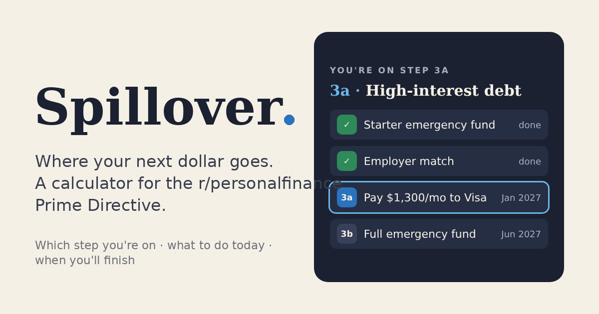

# Spillover

**Where your next dollar goes.** A free calculator for the [r/personalfinance Prime Directive](https://www.reddit.com/r/personalfinance/wiki/commontopics/) that uses your real balances.

**Try it:** [kylescheer.com/spillover](https://kylescheer.com/spillover/)

Most "order of operations" tools stop at telling you which step you're on. Spillover tells you what to do about it:

- **What to move today** from the cash you actually have, e.g. *"Move $1,400 today: $650 to Store card and $750 to Visa."*
- **A monthly rule you can follow:** right before payday, move whatever is in checking above your cushion to the current step.
- **When each step is done**, from a month-by-month projection.
- **"I did these"** updates your balances after you make the moves, so the plan moves on to the next step. It can be undone.

No account, no bank login, no server. Everything stays in your browser.

## The order

Spillover fills each step before money spills into the next one.

| Step | What | Target |
|---|---|---|
| 0 | Budget | Take-home pay minus essentials (including debt minimums) |
| 1 | Starter emergency fund | $1,000 or one month of expenses, whichever is more, plus a checking cushion |
| 2 | Employer match | Contribute enough to get the full 401(k) match |
| 3a | High-interest debt | 10%+ APR, avalanche or snowball |
| 3b | Full emergency fund | 3–6 months of expenses |
| 3c | Moderate-interest debt | 4–10% APR (under 4%: minimums only) |
| 4a | IRA | Yearly IRS limit |
| 4b | Required upcoming costs | Things you'll have to pay soon no matter what |
| 5 | Retirement to 15% | 15% of pre-tax income, counting the match and IRA |
| 6a | HSA | If on a high-deductible health plan |
| 6b | Kids' college (529) | After your own retirement is on track |
| 6c | Goals you want | Travel, a house, a nicer car |
| 6d | Invest the rest | Max the 401(k), then a taxable brokerage account |

The one addition to the Prime Directive is the **checking cushion** (default 1 month, adjustable to 0–2). One month is held at step 1; any extra month comes at step 3b so it doesn't slow down paying off expensive debt.

## How the projection works

Each month, extra money (take-home minus essentials) runs through the steps in order. Debts grow by their APR and shrink by their minimum payment. When a debt is paid off, its minimum joins the monthly extra. Raising a 401(k) contribution lowers take-home pay, assuming about 20% of each pre-tax dollar comes back as lower taxes. IRA, HSA and 529 room resets every January, using each year's IRS limits.

## Running it

It's one self-contained HTML file with no build step and no dependencies. Open `index.html` in a browser, or serve the folder with any static host (GitHub Pages works).

Saved numbers live in `localStorage`. "More → Save a backup file" exports them as JSON, and "Open a backup file" restores them.

## Yearly maintenance

Each November the IRS announces next year's contribution limits. Add a row to the `LIMITS` table near the top of the script (IRA, 401(k), HSA self/family and the Roth IRA income phase-outs). Years the IRS hasn't announced yet fall back to the latest known limits.

## Disclaimer

A planning tool, not financial advice. Built for US accounts and tax rules. Not affiliated with Reddit or r/personalfinance.

## License

[GPL-3.0](LICENSE)

Made by [Kyle Scheer](https://kylescheer.com). If it helped, [buy me a coffee](https://ko-fi.com/scheerapps).
